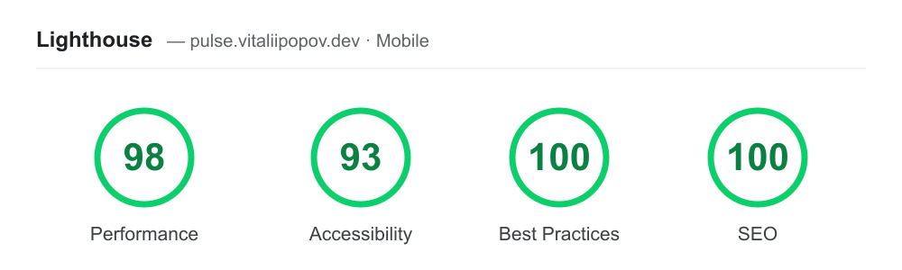

# Pulse — Live Ops Console

[](https://github.com/Yeezy2277/live-ops-console/actions/workflows/ci.yml)
[](https://github.com/Yeezy2277/live-ops-console/actions/workflows/codeql.yml)

A real-time operations console for a fictional multiplayer game — the kind of
"control room" a live-ops team watches. **There is no backend:** the game world
is *simulated on the client* and painted on `<canvas>`, so the whole thing runs
as a static site on free hosting.

> **Live demo:** <https://pulse.vitaliipopov.dev> · no backend, no login

It's a deliberate change of register from the rest of my portfolio (which is
Contentful-heavy): this one is about **real-time UI** — high-frequency state,
smooth 60fps canvas rendering, and keeping React out of the hot path — the kind
of work I did owning the client UI of a real-time multiplayer game.

## Performance

Lighthouse (PageSpeed Insights) on the live app — mobile:



## Try it

- **Break something.** Pick a region and inject a latency spike, an outage or a
  player surge. The console reacts in real time.
- **Watch alerting behave like production alerting.** An outage pages on the next
  tick; a latency spike waits 3 ticks before opening and needs 6 clearly-good
  ticks to resolve. Hovering around the threshold doesn't flap. Acknowledge an
  alert to silence it: it stays open until the metric actually recovers.
- **Step through an incident.** Pause, then advance one tick at a time.
- **Replay a run.** Every run has a seed; *Copy replay link* gives
  `?seed=…`, and the same seed plus the same injections replays identically.
- **See the architecture, measured.** The HUD under the intro shows canvas
  frames per second, milliseconds per frame, and React renders per second,
  live. The canvas runs at the display's refresh rate while React re-renders
  only at the 4 Hz tick (dev builds count React renders twice because of
  StrictMode).

## What it shows

- **World map** — regions as pulsing canvas markers, sized by population and
  coloured by health (healthy / degraded / down), with a live mesh between them.
- **Live metrics** — players online, matches/min, credits/min and p95 latency,
  each with a canvas sparkline of its recent history.
- **Event stream** — a feed of world events (joins, matches, trades, incidents),
  filterable by kind and a **debounced** search box.
- **Economy** — currency balances with per-minute flow and a live item leaderboard.

## The interesting part — architecture

- **A simulation engine** ([`src/sim/world.ts`](src/sim/world.ts)) is the
  self-contained real-time data source: one `step()` advances the world
  (population random-walks, economy flows, regions degrade and recover, events
  fire). It's driven by a **seeded PRNG**, so a given seed replays identically —
  which is exactly what makes the logic unit-testable.
- **One observable store** ([`src/store/store.ts`](src/store/store.ts)) ticks the
  sim on an interval and exposes a version via `useSyncExternalStore`. Cheap
  scalar views (numbers, feed) re-render at the 4Hz tick rate.
- **Alerting with hysteresis** ([`src/sim/alerts.ts`](src/sim/alerts.ts)): each
  rule has a raise threshold and a lower clear threshold, plus how many
  consecutive ticks each must hold. Pure and unit-tested, including the
  "no flapping around the threshold" case.
- **Canvas views run their own `requestAnimationFrame` loop** off the store and
  never re-render through React — so the map's 60fps pulse animation is fully
  decoupled from React reconciliation. That split (cheap UI at tick rate,
  expensive drawing at frame rate) is the whole point.

## Design

A flight-deck display: Chakra Petch for labels, JetBrains Mono for every
number, graphite panels with HUD corner brackets, and a radar-scope map with
scanlines and a slow sweep. Colour follows avionics convention so it carries
meaning: cyan is information and the selected control, green nominal, amber
caution, red warning. Panels boot in with one staggered reveal; all motion
(including the sweep and the pulsing markers) stops under
`prefers-reduced-motion`. Light theme reads as the same cockpit in daylight.

## Run it

```bash
npm install
npm run dev        # http://localhost:5173
npm test           # Vitest: sim, alerting and RNG unit tests + component tests (RTL, jsdom)
npm run build      # static bundle in dist/
```

Stack: React 18 · TypeScript · Vite · Canvas 2D · Google Fonts (Chakra Petch, JetBrains Mono). No runtime dependencies beyond
React — ~50 kB gzipped.
